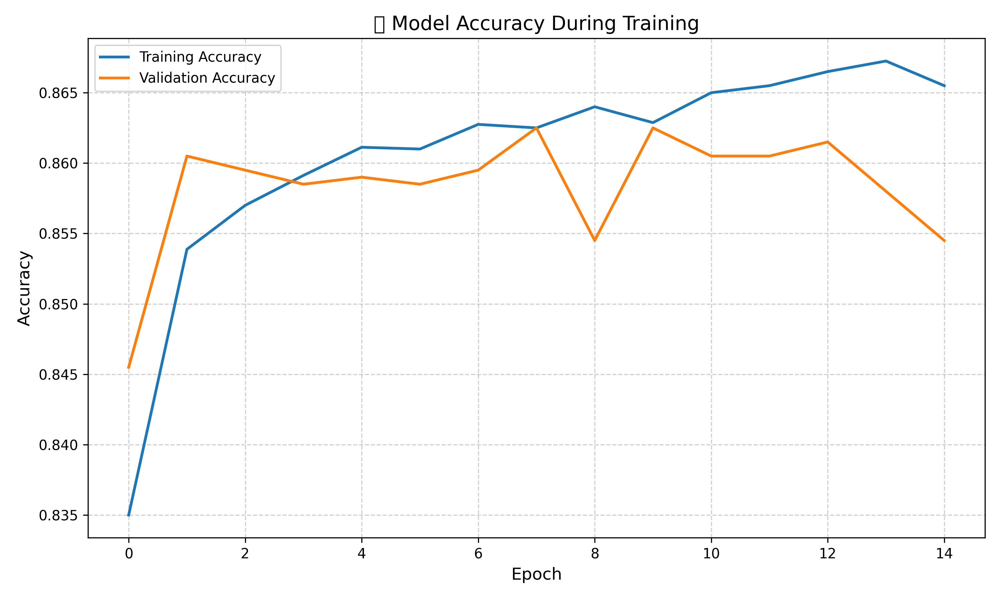
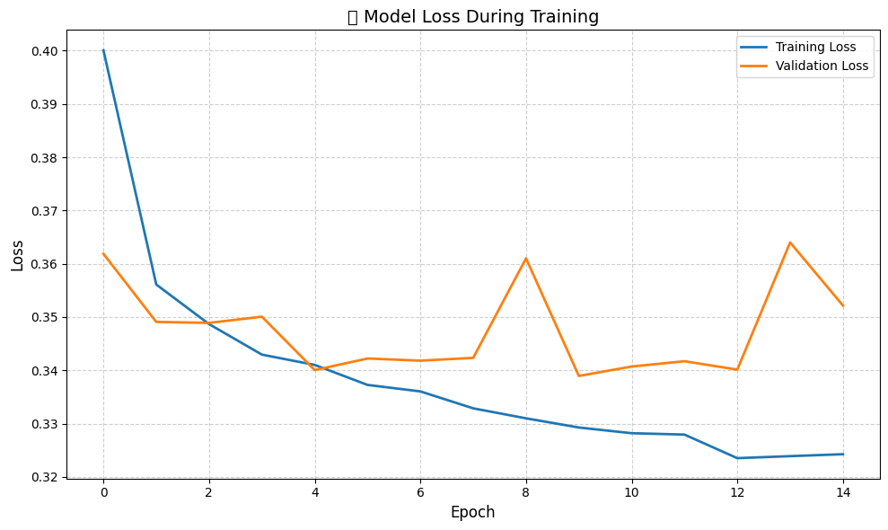

# 🧠 Deep Learning ANN - Customer Churn Prediction

This project implements an **Artificial Neural Network (ANN)** using **TensorFlow and Keras** to predict **customer churn** based on demographic and account-related data.  
It includes a complete workflow — from model training and evaluation to deployment on **Streamlit Cloud**.

---

## 🚀 Project Overview

Customer churn prediction helps businesses identify customers likely to leave a service.  
By analyzing patterns in customer data, companies can take proactive steps to retain them.

This project demonstrates an **end-to-end machine learning lifecycle**:
1. Data preprocessing  
2. Feature encoding and scaling  
3. ANN model design and training  
4. Model evaluation  
5. Deployment via Streamlit

---

## 🗂️ Folder Structure
```

.
├── app.py # Streamlit app for user interaction
├── artifacts/ # Saved models and encoders
│ ├── churn_model.h5 # Trained ANN model
│ ├── label_encoder_gender.pkl # Label encoder for Gender
│ ├── onehot_encoder_geography.pkl # One-hot encoder for Geography
│ └── scaler.pkl # StandardScaler for numerical features
├── Churn_Modelling.csv # Dataset used for training
├── logs/ # Model training logs
│ └── fit # Keras training logs
├── notebooks/ # Jupyter notebooks for experimentation
│ ├── experiments.ipynb # Model training and tuning
│ └── prediction.ipynb # Testing and predictions
├── requirements.txt # Python dependencies
├── README.md # Project documentation
```
## 🧩 Technologies Used

| Category | Tools / Libraries |
|-----------|-------------------|
| **Language** | [](https://www.python.org/) |
| **Framework** | [](https://streamlit.io/) |
| **Deep Learning** | [](https://www.tensorflow.org/) [](https://keras.io/) |
| **Data Processing** | [](https://pandas.pydata.org/) [](https://numpy.org/) [](https://scikit-learn.org/stable/) |
| **Visualization** | [](https://matplotlib.org/) [](https://seaborn.pydata.org/) |
| **Model Deployment** | [](https://streamlit.io/cloud) |

## ⚙️ Installation

### 1️⃣ Clone the repository
```bash
git clone https://github.com/rahul15-manch/deep-learning-ann.git
cd deep-learning-ann
```
### 2️⃣ Create a virtual environment (optional)
```
python -m venv venv
source venv/bin/activate   # for macOS/Linux
venv\Scripts\activate      # for Windows
```
### 3️⃣ Install dependencies
```
pip install -r requirements.txt
```
### 4️⃣ Run the app
```
streamlit run app.py
```
## 🧠 Model Architecture
The ANN consists of:

- Input layer (11 features after encoding)

- Two hidden layers with ReLU activation

- Output layer with sigmoid activation (for binary classification)

  - Optimizer: Adam
  - Loss: Binary Crossentropy
  - Metric: Accuracy

## 📊 Dataset Details
**File: Churn_Modelling.csv**
### Contains customer information from a bank, including:

- Feature	Description
- CreditScore: Customer credit score
- Geography: Country
- Gender: Male/Female
- Age: Customer’s age
- Tenure: Number of years with the bank
- Balance: Account balance
- NumOfProducts: Number of bank products
- HasCrCard: Credit card holder (1 = Yes)
- IsActiveMember: Active membership (1 = Yes)
- EstimatedSalary: Salary estimate
- Exited: Target variable (1 = Churned)
## 📈 Model Accuracy

The Artificial Neural Network (ANN) was trained for **100 epochs** with the following performance:

| Metric | Training | Validation |
|---------|-----------|------------|
| **Final Accuracy** | **86.7%** | **86.3%** |
| **Final Loss** | **0.32** | **0.34** |

🧠 The model shows good generalization, as training and validation accuracies are close — indicating minimal overfitting.

---

### 📊 Training Progress

| Epoch | Training Accuracy | Validation Accuracy | Training Loss | Validation Loss |
|-------|--------------------|----------------------|----------------|------------------|
| 1 | 83.5% | 85.5% | 0.395 | 0.353 |
| 5 | 86.4% | 85.9% | 0.340 | 0.343 |
| 8 | 86.5% | 86.3% | 0.332 | 0.341 |
| 13 | 86.7% | 85.5% | 0.322 | 0.354 |

---

### 🧾 Summary

✅ Stable training — no significant overfitting  
✅ Validation accuracy plateaued around **86%**, suitable for production prediction  
✅ Can be further tuned using:
- Dropout regularization  
- Batch normalization  
- Learning rate scheduling  

---

### 📉 Accuracy and Loss Curve 



## 🌐 Deployment


The app is live here 👉 [](https://rahul15-manch-deep-learning-ann-app-ks203y.streamlit.app/)


## 🧾 Author

**👨‍💻 Rahul Manchanda**  
📍 *Data Enthusiast | Machine Learning & Deep Learning*  

[](https://www.linkedin.com/in/rahul-manchanda-3959b120a/)  
[](https://github.com/rahul15-manch)  
[](https://www.instagram.com/rahulmanchanda015/?__pwa=1)


